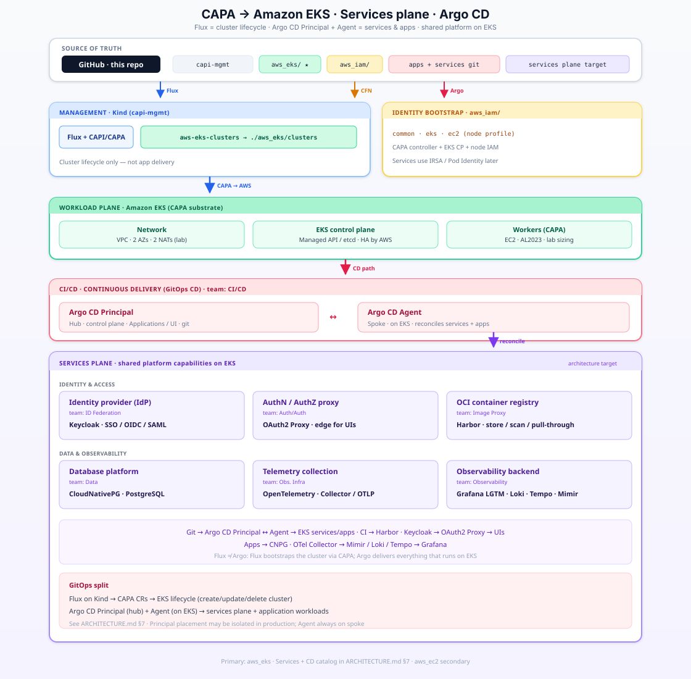

# SCKE Transformative Architecture

Arch. adaptation from On-Prem to AWS Cloud Services Hosting — **Cluster API + CAPA** → **Amazon EKS**, with a **Services plane** on that cluster.

**Docs:** [ARCHITECTURE.md](ARCHITECTURE.md) · [docs/platform-candidates.md](docs/platform-candidates.md) (pin AWS / elect OSS / eliminate) · [docs/architecture.svg](docs/architecture.svg) (full size)

## Architecture diagram

Click the preview for the full SVG.

**Management cluster: TBD** — not fixed in the architecture (see [ARCHITECTURE.md](ARCHITECTURE.md)).

## Primary path: EKS + Services plane

| Path | Owns | Apply how |
|------|------|-----------|
| **`aws_eks/`** | EKS CAPA cluster YAML (`AWSManagedControlPlane`, workers) + optional KMS CFN | CAPA (management host TBD) → AWS; keep Flux `resources: []` in dev |
| **`aws_iam/`** | CAPA IAM CloudFormation | `aws cloudformation deploy --template-file …` (only when applying) |
| **`aws_cost/`** | Lab budget CFN (optional) | CLI deploy when ready — not Flux |

### Services plane (on EKS — architecture target)

| Industry capability | Team name | Stack |
|---------------------|-----------|--------|
| Continuous delivery (GitOps CD) | CI/CD | Argo CD **Principal** + **Agent** |
| Node autoscaling | Compute | Karpenter |
| Backup & restore (also Workload) | Resilience | Velero |
| Secrets management | Secrets | OpenBao |
| Secrets synchronization | Secrets | External Secrets Operator |
| Database platform | Data | CloudNativePG |
| OCI container registry | Image Proxy | Harbor |
| AuthN/AuthZ proxy | Auth/Auth | OAuth2 Proxy |
| Identity provider (IdP) | ID Federation | Keycloak |
| Telemetry collection | Obs. Infra | OpenTelemetry |
| Observability backend | Observability | Grafana · Loki · Tempo · Mimir (LGTM) |

See [ARCHITECTURE.md §7](ARCHITECTURE.md#7-services-plane).

**Workload plane (also on EKS):** CAPA substrate + **Argo CD Agent**, **Knative**, **Velero** (Velero also on Services).

## IAM (one place only)

All CAPA IAM lives under **`aws_iam/`** — not under `aws_eks/`.

| Stack | Template | Use for EKS |
|-------|----------|-------------|
| `capa-iam-common` | `aws_iam/common.yaml` | Always |
| `capa-iam-eks` | `aws_iam/eks.yaml` | EKS control plane + controller policy |
| `capa-iam-ec2` | `aws_iam/ec2-self-managed.yaml` | Node instance profile (current worker flavor) |

See [`aws_iam/README.md`](aws_iam/README.md).

## Secondary: `aws_ec2/`

Self-managed kubeadm path exists under [`aws_ec2/`](aws_ec2/) but is **not** the architecture focus. It will be reshaped as a **clone of the EKS operating model** later.

## Other paths

| Path | Owns |
|------|------|
| **`clusters/capi-mgmt/`** | Lab / experimental management material — **not** the architectural management plane |
| **`local/`** | Process notes, secrets (gitignored) — never commit |
| **`.planning/handoffs/`** | Session handoffs |
| **`graphify-out/`** | Knowledge graph artifacts (gitignored) |

## Rules

1. **YAML first** for anything that creates/changes AWS.  
2. CAPA reconciles to **AWS**; **Services plane** (incl. Argo CD CI/CD) runs on **EKS**.  
3. **Management cluster is TBD** — do not treat experimental mgmt paths as the design.  
4. No secrets in git.  
5. EKS lab cost floor: **2 AZs / 2 NATs** (`availabilityZoneUsageLimit: 2` on the managed control plane VPC).  
6. **Dev mode:** do not enable Flux cluster resources or `git push` until you intend AWS creates.
